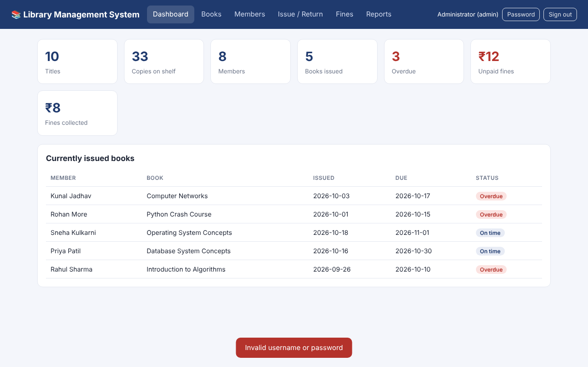
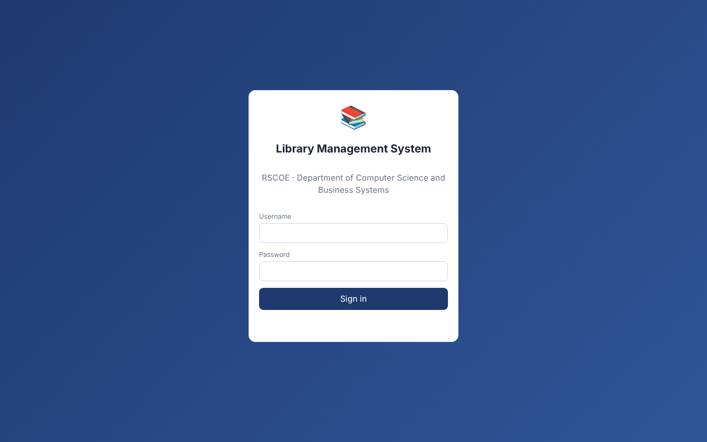
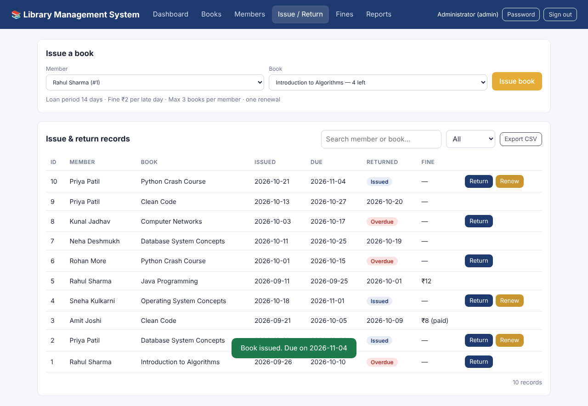
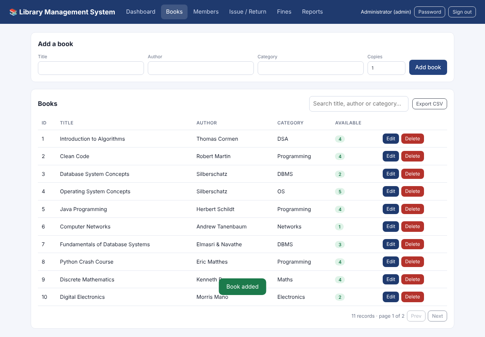
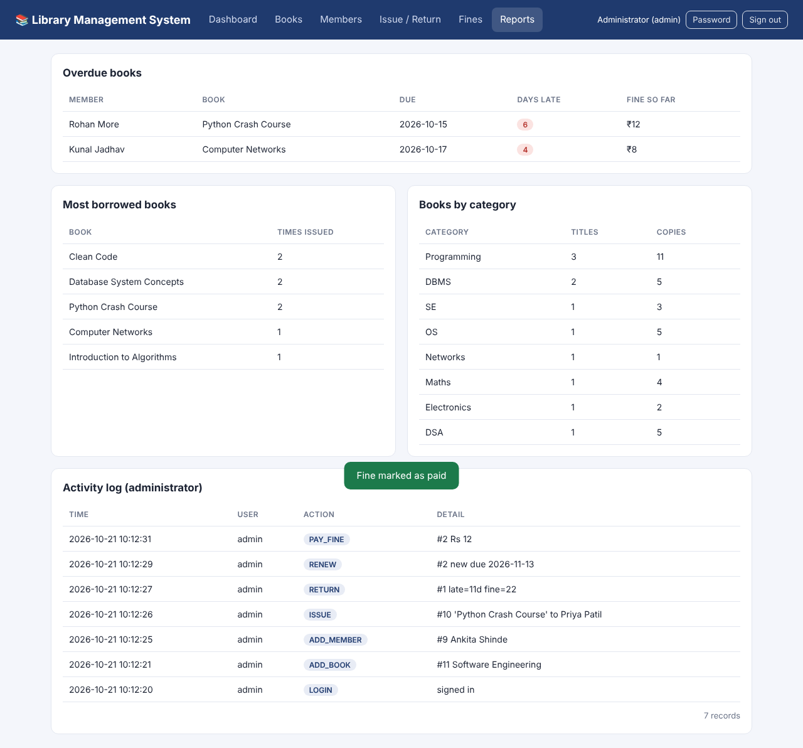

# Library Management System

A two-tier web application for running a college library day to day: a browser front end, a Flask REST back end and a MySQL database.
Built as a DBMS mini project (JSPM's Rajarshi Shahu College of Engineering, Pune – Dept. of Computer Science and Business Systems).



## Features

| Area | What it does |
|------|--------------|
| Circulation | Issue, return and renew books (14-day loan, one renewal), automatic fine of ₹2 per late day |
| Catalogue | Add, edit, search and delete books and members; pagination on every list |
| Rules enforced by the server | Stock check, max 3 books per member, no duplicate copy, no borrowing with an unpaid fine |
| Reliability | Every multi-table change runs in one transaction; stock update is atomic (`Quantity - 1 WHERE Quantity > 0`); JSON error handling; rotating log file |
| Security | Librarian login with PBKDF2-hashed passwords, roles (admin / librarian), CSRF token, login lock-out after repeated failures, parameterised SQL, CSV-injection-safe exports |
| Operations | `/health` endpoint, one-command backup (`mysqldump` / SQLite backup, keeps 14), Docker Compose, GitHub Actions CI |
| Reports | Overdue list, most-borrowed books, books by category, CSV export, activity (audit) log for admins |

## Architecture

```
Browser (HTML/CSS/JS)  --JSON-->  Flask REST API (app/)  --SQL-->  MySQL 8 (LibraryDB)
```

Tables: `Member`, `Book`, `Issue`, `Fine`, `Librarian`, `Audit_Log` + view `vw_overdue` (see `docs/diagrams/er.png`).

## Quick start (Docker – recommended)

```bash
cp .env.example .env        # set SECRET_KEY, DB_PASSWORD, ADMIN_PASSWORD
docker compose up --build   # http://localhost:8000
```
The first start creates the schema and loads **sample data** (members, books, issues). For a real library, change `python manage.py seed` to `python manage.py init-db` in `docker-compose.yml`, then create your admin with `docker compose exec web python manage.py create-user <username> "<Full Name>" --role admin`.

## Quick start (without Docker)

```bash
python -m venv .venv && source .venv/bin/activate      # Windows: .venv\Scripts\activate
pip install -r requirements.txt
cp .env.example .env                                   # edit DB_* values
python manage.py init-db        # creates LibraryDB tables in MySQL (or: mysql -u root -p < schema/mysql.sql)
python manage.py seed           # optional sample data + first admin (password printed if ADMIN_PASSWORD empty)
python run.py                   # http://127.0.0.1:5000
```
Optional stored procedure and trigger: run `schema/mysql_extras.sql` in MySQL Workbench.

**Try it without MySQL:** set `DB_ENGINE=sqlite` in `.env` (same tables, same code).

## Daily-use commands

| Command | Purpose |
|---------|---------|
| `python manage.py backup` | Dated backup in `backups/` (schedule it daily with cron / Task Scheduler) |
| `python manage.py create-user NAME "Full Name" --role librarian` | Add a staff account |
| `python -m unittest discover -v` | Run the 27 automated tests |
| `gunicorn -w 3 -b 0.0.0.0:8000 wsgi:app` | Production server (used by Docker) |

Use HTTPS in production and set `COOKIE_SECURE=1`.

## Project layout

```
app/            Flask application (api.py routes, auth.py, db.py, config.py, templates/, static/)
schema/         mysql.sql, mysql_extras.sql, sqlite.sql
tests/          27 unit/integration tests
docs/           report, presentation, screenshots, diagrams
manage.py       init-db, seed, create-user, backup
Dockerfile, docker-compose.yml, .github/workflows/ci.yml
```

## Screenshots

| | |
|-|-|
|  |  |
|  |  |

## Authors

Premraj Gopichand Goykar (RBT25CB036) · Harshadeep Praful Thul (RBT25CB022)
Guide: Prof. Rutuja S. Bachhav · Course: Database Management System · AY 2026-27

Licensed under the MIT License.
