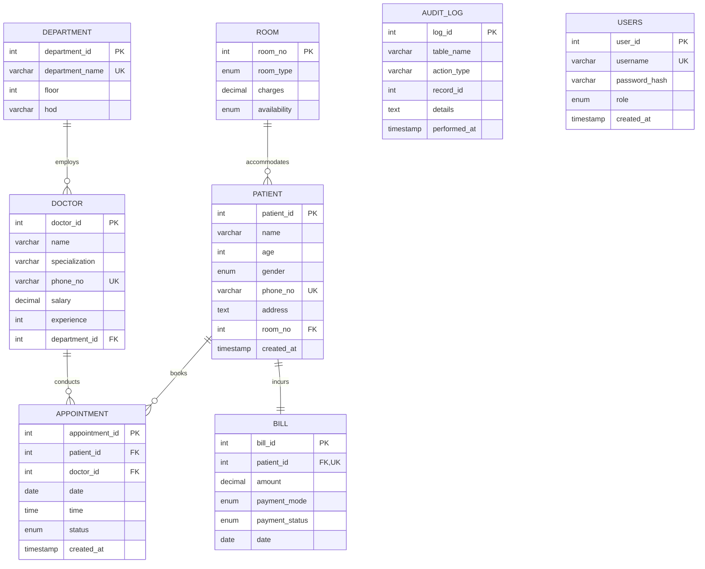

# Antigravity Hospital Management System (HMS)
### DBMS Mini Project 2026-27 • Department of CSBS (SY)
**Student Roll No:** `RBT25CB011`  
**GitHub Username:** `@swastik1248`

---


## 📋 Table of Contents
1. [Project Overview](#project-overview)
2. [Database Architecture & 6 Core Entities](#database-architecture--6-core-entities)
3. [Entity-Relationship (ER) Diagram](#entity-relationship-er-diagram)
4. [Relational Schema & 3NF Normalization Proof](#relational-schema--3nf-normalization-proof)
5. [File Structure](#file-structure)
6. [Step-by-Step Execution Guide](#step-by-step-execution-guide)
7. [Advanced DBMS Features Implemented](#advanced-dbms-features-implemented)
8. [Viva Voce Examination Guide (Q&A)](#viva-voce-examination-guide-qa)

---

## 1. Project Overview

The **Hospital Management System (hospital_db)** automates clinic operations, patient admissions, outpatient scheduling, room allocation, and financial auditing. 

- **Database Engine**: `InnoDB` (guarantees strict Foreign Key enforcement, crash recovery, and ACID compliance).
- **Character Encoding**: `utf8mb4` with `utf8mb4_unicode_ci` (full internationalization and currency symbol support e.g. `₹`).
- **Data Integrity**: Enforced using `PRIMARY KEY`, `FOREIGN KEY`, `UNIQUE`, `NOT NULL`, and `CHECK` constraints.
- **Security & Auditing**: Role-based access table (`users`) and event-driven audit logging (`audit_log`).

---

## 2. Database Architecture & 6 Core Entities

| # | Entity Table | Primary Key | Description | Key Relationships |
|---|-------------|-------------|-------------|-------------------|
| 1 | `department` | `department_id` | Medical divisions & HOD details | 1:M with `doctor` |
| 2 | `doctor` | `doctor_id` | Physician profiles, specialization, salary | M:1 with `department`, 1:M with `appointment` |
| 3 | `room` | `room_no` | Inpatient wards, pricing & occupancy status | 1:M with `patient` |
| 4 | `patient` | `patient_id` | Inpatients/Outpatients demographic data | M:1 with `room` (NULL for outpatients), 1:M with `appointment`, 1:1 with `bill` |
| 5 | `appointment` | `appointment_id` | Doctor-patient consultation bookings | M:1 with `patient`, M:1 with `doctor` |
| 6 | `bill` | `bill_id` | Financial settlement & invoices | 1:1 with `patient` |
| 7 | `users` | `user_id` | RBAC Authentication (Admin / Staff) | Standalone security table |
| 8 | `audit_log` | `log_id` | Autonomous change tracking via triggers | Standalone compliance table |

---

## 3. Entity-Relationship (ER) Diagram



---

## 4. Relational Schema & 3NF Normalization Proof

### Relational Schema Representation
- **DEPARTMENT** (<ins>department_id</ins>, department_name, floor, hod)
- **DOCTOR** (<ins>doctor_id</ins>, name, specialization, phone_no, salary, experience, *department_id*)
- **ROOM** (<ins>room_no</ins>, room_type, charges, availability)
- **PATIENT** (<ins>patient_id</ins>, name, age, gender, phone_no, address, *room_no*, created_at)
- **APPOINTMENT** (<ins>appointment_id</ins>, *patient_id*, *doctor_id*, date, time, status, created_at)
- **BILL** (<ins>bill_id</ins>, *patient_id*, amount, payment_mode, payment_status, date)
- **USERS** (<ins>user_id</ins>, username, password_hash, role, created_at)
- **AUDIT_LOG** (<ins>log_id</ins>, table_name, action_type, record_id, details, performed_at)

### Normalization Justification

1. **First Normal Form (1NF)**:
   - Every column holds strictly atomic (indivisible) scalar values.
   - No repeating groups or multivalued columns (e.g., patient phone numbers and appointments are separated into dedicated relational entities).
   - Each table has a designated Primary Key.

2. **Second Normal Form (2NF)**:
   - Meets 1NF.
   - All non-key attributes are fully functionally dependent on the primary key.
   - For composite unique keys (such as `(doctor_id, date, time)` in `appointment`), no non-key attribute depends on a proper subset of the key.

3. **Third Normal Form (3NF)**:
   - Meets 2NF.
   - Transitive dependencies are eliminated ($X \rightarrow Y$ and $Y \rightarrow Z$).
   - Doctor salary and experience depend exclusively on `doctor_id`, while department info is factored into `department` rather than repeating HOD and floor inside `doctor`.
   - Patient admission rooms are referenced via `room_no` foreign key rather than storing room charges and types directly inside `patient`.

---

## 5. File Structure

```
hospital_management_db/
├── 01_schema.sql             # DDL: Tables, Constraints, Checks, and Indexes
├── 02_seed.sql               # DML: Complete Demonstration Records
├── 03_advanced_features.sql  # Programmability: Views, Procedures, Function, Trigger
├── 04_viva_demonstration.sql # Verification Queries, Analytics, and ACID Tests
├── run_all.sql               # Single-click master execution script
├── run_db.bat                # Windows Batch launcher for MySQL Server
├── run_db.ps1                # PowerShell automated execution script
└── README.md                 # Project Report & Viva Voce Guide
```

---

## 6. Step-by-Step Execution Guide

### Option A: Running inside MySQL Workbench (Recommended)
1. Open **MySQL Workbench** and connect to your local MySQL instance.
2. Go to **File -> Open SQL Script...** and select [run_all.sql](file:///C:/Users/swast/.gemini/antigravity-ide/scratch/hospital_management_db/run_all.sql).
3. Click the **Execute (Lightning Bolt)** icon.
4. Open [04_viva_demonstration.sql](file:///C:/Users/swast/.gemini/antigravity-ide/scratch/hospital_management_db/04_viva_demonstration.sql) and execute individual query blocks during your viva examination.

### Option B: Running from Windows Terminal / PowerShell
1. Open PowerShell and navigate to the project directory:
   ```powershell
   cd C:\Users\swast\.gemini\antigravity-ide\scratch\hospital_management_db
   ```
2. Execute the PowerShell runner:
   ```powershell
   .\run_db.ps1
   ```
   Or double-click `run_db.bat`.

---

## 7. Advanced DBMS Features Implemented

### 1. Relational Views
- `v_appointment_overview`: Joins 4 tables (`appointment`, `patient`, `doctor`, `department`) providing an integrated clinical schedule without exposing sensitive payroll data.
- `v_patient_billing_summary`: Joins `patient`, `room`, and `bill` using `LEFT JOIN` and `IFNULL` to display active inpatients, daily bed rates, and outstanding payment balances.

### 2. Stored Procedures
- `sp_schedule_appointment(patient_id, doctor_id, date, time, OUT status_msg)`: 
  Prevents double-booking by verifying active non-cancelled slots before creating an appointment record.
- `sp_assign_room(patient_id, room_no, OUT result)`: 
  Enforces atomic bed allocation by validating room availability, assigning the patient, and toggling room status to `'Occupied'`.

### 3. Stored Function
- `fn_get_department_total_revenue(dept_id)`:
  Deterministic SQL function that traverses the relational path (`department -> doctor -> appointment -> patient -> bill`) to aggregate paid revenue in INR for any department.

### 4. Database Trigger
- `trg_after_bill_payment_update`:
  Executes automatically `AFTER UPDATE ON bill`. Whenever `payment_status` changes, it writes an audit entry to `audit_log` with before/after state and timestamp.

### 5. Indexing Strategy
- `idx_appointment_date`: Accelerates day-by-day appointment schedule queries.
- `idx_appointment_doc_status`: Composite index optimizing doctor queue lookups.
- `idx_patient_phone`: B-Tree index for instantaneous patient lookups at registration.
- `idx_room_availability`: Filter optimization for available bed queries.

---

## 8. Viva Voce Examination Guide (Q&A)

### Q1: Why did you choose InnoDB over MyISAM as the storage engine?
**Answer**: `InnoDB` provides ACID transaction compliance, row-level locking for concurrent transactions, crash recovery with write-ahead redo logs, and strict Foreign Key constraint enforcement. `MyISAM` only supports table-level locking and lacks foreign key enforcement.

### Q2: What is the difference between `ON DELETE CASCADE` and `ON DELETE RESTRICT` in your schema?
**Answer**: 
- In `appointment`, `ON DELETE CASCADE` is set on `patient_id` so deleting a patient cleans up their appointments.
- In `doctor`, `ON DELETE RESTRICT` is set on `department_id`. A department cannot be deleted if doctors are assigned to it, preventing orphaned employee records.

### Q3: How is 1:1 relationship between Patient and Bill enforced?
**Answer**: By placing a `UNIQUE` constraint on the `patient_id` foreign key column in the `bill` table (`patient_id INT NOT NULL UNIQUE`). This ensures no patient can have more than one bill record.

### Q4: What is the difference between a Stored Procedure and a Stored Function in MySQL?
**Answer**:
- **Stored Function**: Must return a single scalar value via the `RETURNS` clause, can be invoked directly inside SQL statements (e.g., `SELECT fn_get_department_total_revenue(1);`), and cannot execute transactions.
- **Stored Procedure**: Invoked with the `CALL` keyword, can return multiple values through `OUT`/`INOUT` parameters or result sets, and can execute transaction commands (`COMMIT`/`ROLLBACK`).

### Q5: How does your trigger maintain audit compliance?
**Answer**: The trigger `trg_after_bill_payment_update` fires on `AFTER UPDATE` of `bill`. It evaluates `IF OLD.payment_status <> NEW.payment_status` and writes the old state, new state, user action, and record ID into `audit_log`.

### Q6: How do you prevent double booking for doctors?
**Answer**: At the schema level, a composite unique key `CONSTRAINT uq_doctor_time_slot UNIQUE (doctor_id, date, time)` prevents duplicate physical entries. At the application level, `sp_schedule_appointment` performs conflict validation and returns a clear descriptive message (`ERROR: Doctor is already booked...`).

### Q7: What are the ACID properties and how are they demonstrated?
**Answer**:
- **Atomicity**: Demonstrating that inserting a patient and updating room status happen as one all-or-nothing unit using `START TRANSACTION; ... COMMIT;`.
- **Consistency**: Enforced through `CHECK (salary > 0)`, `CHECK (age BETWEEN 0 AND 120)`, and foreign keys.
- **Isolation**: Handled by InnoDB multi-version concurrency control (MVCC) and row-level locking.
- **Durability**: Committed changes persist to disk via redo logs even in case of system power failure.
