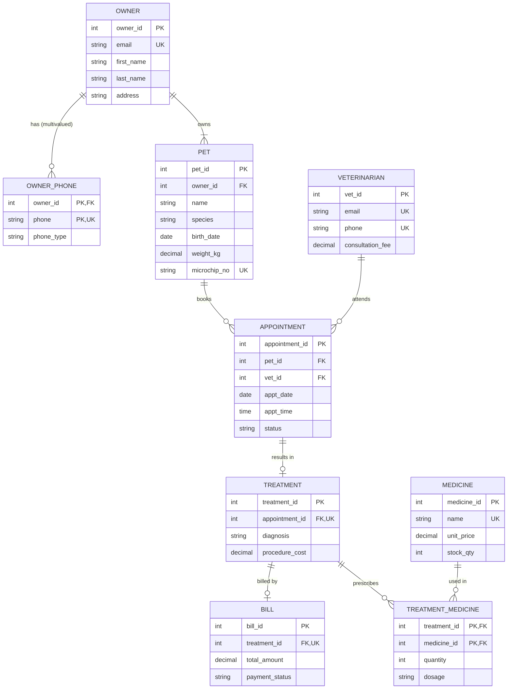

# PetCare – Database Design

## 1. ER Diagram (Mermaid – renders in GitHub / VS Code "Markdown Preview Mermaid" / mermaid.live)

## 2. Relational Schema
OWNER(**owner_id**, first_name, last_name, email, address, registered_on)
OWNER_PHONE(**owner_id**↗OWNER, **phone**, phone_type)
PET(**pet_id**, owner_id↗OWNER, name, species, breed, gender, birth_date, weight_kg, microchip_no)
VETERINARIAN(**vet_id**, full_name, specialization, email, phone, consultation_fee)
APPOINTMENT(**appointment_id**, pet_id↗PET, vet_id↗VETERINARIAN, appt_date, appt_time, reason, status)
TREATMENT(**treatment_id**, appointment_id↗APPOINTMENT, diagnosis, procedure_name, procedure_cost, treated_on)
MEDICINE(**medicine_id**, name, category, unit_price, stock_qty, reorder_level, expiry_date)
TREATMENT_MEDICINE(**treatment_id**↗TREATMENT, **medicine_id**↗MEDICINE, quantity, dosage)
BILL(**bill_id**, treatment_id↗TREATMENT, bill_date, consultation_fee, procedure_cost, medicine_cost, total_amount, payment_status, payment_method)

## 3. Keys
| Key type | Examples |
|---|---|
| Primary | owner_id, pet_id, vet_id, appointment_id, treatment_id, medicine_id, bill_id |
| Composite primary | OWNER_PHONE(owner_id, phone); TREATMENT_MEDICINE(treatment_id, medicine_id) |
| Foreign | PET.owner_id, APPOINTMENT.pet_id/vet_id, TREATMENT.appointment_id, BILL.treatment_id … |
| Candidate | owner.email, vet.email, vet.phone, pet.microchip_no, medicine.name, (owner_id, pet.name), (vet_id, appt_date, appt_time) |
| Alternate | Candidate keys not chosen as PK, e.g. owner.email, medicine.name, owner_phone.phone |

## 4. Attribute types
- **Simple**: pet.name, medicine.unit_price
- **Composite**: owner name (first_name + last_name); address
- **Multivalued**: owner phone numbers → separate table OWNER_PHONE
- **Derived**: pet age (`fn_pet_age(birth_date)`), bill total (consultation + procedure + medicine), owner dues (`fn_owner_due`)

## 5. Cardinalities
| Relationship | Cardinality |
|---|---|
| OWNER – PET | 1 : N (total participation of PET) |
| OWNER – OWNER_PHONE | 1 : N |
| PET – APPOINTMENT | 1 : N |
| VETERINARIAN – APPOINTMENT | 1 : N |
| APPOINTMENT – TREATMENT | 1 : 0..1 |
| TREATMENT – BILL | 1 : 0..1 |
| TREATMENT – MEDICINE | M : N (via TREATMENT_MEDICINE) |

## 6. Functional Dependencies
- owner_id → first_name, last_name, email, address; email → owner_id
- phone → owner_id, phone_type
- pet_id → owner_id, name, species, breed, gender, birth_date, weight_kg, microchip_no
- vet_id → full_name, specialization, email, phone, consultation_fee
- appointment_id → pet_id, vet_id, appt_date, appt_time, reason, status; (vet_id, appt_date, appt_time) → appointment_id
- treatment_id → appointment_id, diagnosis, procedure_name, procedure_cost, treated_on
- medicine_id → name, category, unit_price, stock_qty, reorder_level, expiry_date
- (treatment_id, medicine_id) → quantity, dosage
- bill_id → treatment_id, bill_date, fees, total_amount, payment_status, payment_method

## 7. Normalization (UNF → 3NF)
**UNF** – one big record per visit:
`VISIT(owner_name, {phones}, pet_name, species, birth_date, vet_name, vet_fee, appt_date, status, diagnosis, {medicine_name, price, qty}, bill_total, pay_status)`
Repeating groups `{phones}` and `{medicines}`.

**1NF** – atomic values, no repeating groups: phones become one row each; each medicine used becomes one row. Key = (visit, phone, medicine).

**2NF** – remove partial dependencies on part of the composite key:
medicine_name, price → depend only on medicine; phone → depends only on owner; so split into OWNER_PHONE, MEDICINE, TREATMENT_MEDICINE(treatment_id, medicine_id, qty).

**3NF** – remove transitive dependencies:
pet_id → owner_id → owner_name/email (split OWNER from PET); appointment → vet_id → vet_fee (split VETERINARIAN); treatment → appointment → pet/vet. Result: the 9 tables above, in which every non-key attribute depends on "the key, the whole key, and nothing but the key".

*Controlled denormalization:* BILL stores fee snapshots and `total_amount` so that old bills stay correct when prices change later (maintained by trigger `trg_bill_calc`).

## 8. ACID in this project
| Property | Where |
|---|---|
| Atomicity | `sp_book_appointment`, `sp_pay_bill` – all-or-nothing with ROLLBACK handler |
| Consistency | PK/FK/UNIQUE/CHECK constraints + triggers (stock check, total calc) |
| Isolation | InnoDB MVCC / row locks; default REPEATABLE READ |
| Durability | InnoDB redo log; COMMIT persists data |
