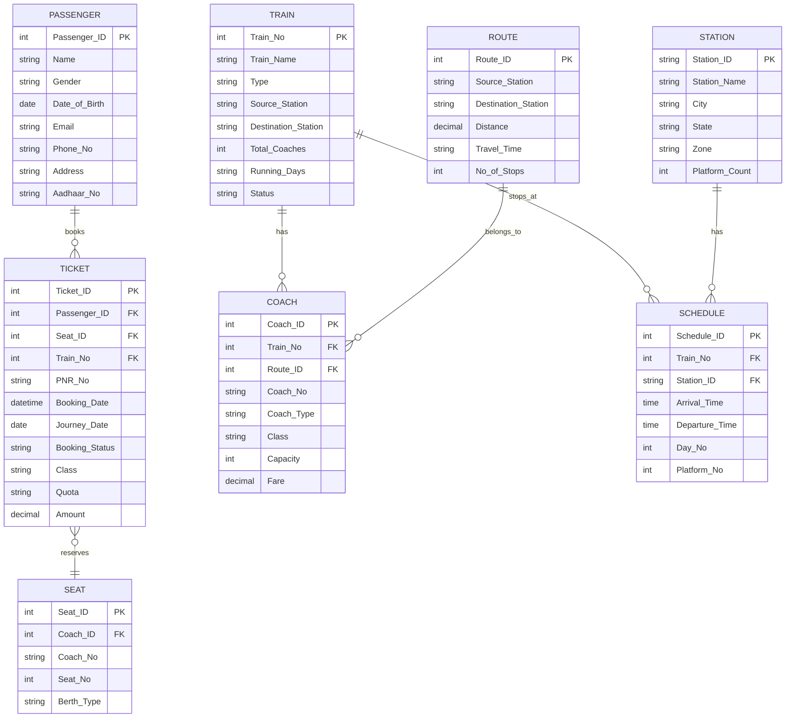

# 🚆 RailConnect — Railway Ticket Booking System

A full-stack Railway Ticket Booking System prototype.
* **Stage 1**: Responsive UI (HTML5, CSS Variables, Vanilla JavaScript) using a Navy Blue, White, and Amber design system.
* **Stage 2**: Relational Database Schema (`schema.sql`), Flask REST backend with parameterized MySQL queries, environment variable configuration, and connection testing.

---

## 📐 Relational Schema (Approved ER Diagram Review)

The database schema is derived directly from the approved ER Diagram (**`Railway_System_ERD.drawio`**). The schema respects all 8 entities, their exact attribute names, and relational cardinalities without modifications:



---

## 📁 File Structure

```text
railway-booking-system/
├── app.py               # Flask backend API with parameterized endpoints
├── db.py                # Database connection manager (mysql-connector-python + dotenv)
├── test_connection.py   # Diagnostic script to test MySQL connectivity
├── init_db.py           # Database migration script that applies schema.sql
├── schema.sql           # Complete relational DDL + clearly labelled fictional test data
├── .env                 # Environment variables (Host, Port, User, Password, DB)
├── .env.example         # Example template for environment configuration
├── index.html           # Stage 1 responsive homepage UI
├── css/
│   └── style.css        # Navy Blue, White & Amber styling system
├── js/
│   └── main.js          # Dynamic frontend script integrated with Flask API
└── assets/
    └── Railway_System_ERD.jpeg  # Copy of approved ER diagram
```

---

## ⚙️ Environment Variables Configuration (`.env`)

Database configuration is decoupled using `python-dotenv`. Edit `.env` in the project root:

```ini
# MySQL Database Configuration
DB_HOST=localhost
DB_PORT=3306
DB_USER=root
DB_PASSWORD=your_mysql_root_password
DB_NAME=railway_db

# Flask Server Configuration
FLASK_APP=app.py
FLASK_DEBUG=True
PORT=5000
```

---

## 🧪 Testing the Database Connection

A standalone diagnostic script is included to verify MySQL connectivity and diagnose credentials:

```powershell
python test_connection.py
```

* **When Connected**: Displays MySQL Server version, active database, and existing table names.
* **If Access Denied**: Outputs the exact error code (e.g. `1045`), troubleshooting guidance, and prompts to set `DB_PASSWORD` in `.env`.

---

## 🛠️ Initializing the Database & Sample Data

Once your credentials in `.env` are configured, initialize the database and load the fictional records:

```powershell
python init_db.py
```

This applies [`schema.sql`](file:///C:/Users/mohit/.gemini/antigravity/scratch/railway-booking-system/schema.sql), which sets up all 8 tables and seeds test records for:
* **8 Stations**: `NDLS`, `MMCT`, `BSB`, `CNB`, `SBC`, `MAS`, `HWH`, `ADI`, `SVDK`
* **4 Routes**: Delhi–Varanasi, Delhi–Mumbai, Bengaluru–Chennai, Howrah–Delhi
* **4 Trains**: Vande Bharat (22436), Tejas Rajdhani (12952), Shatabdi (12028), Howrah Rajdhani (12301)
* **Coaches & Classes**: 3A, 2A, 1A, CC, EC with realistic fares
* **Schedules**: Arrival/departure times, platform numbers, and day numbers
* **Fictional Passengers & Confirmed Tickets**: With 10-digit sample PNR numbers (e.g. `2849102834`)

---

## 🚀 Running the Flask Application

Start the Flask server:

```powershell
python app.py
```

Open your browser at:
```text
http://localhost:5000
```

---

## 🔌 Backend API Endpoints (Parameterized SQL Queries)

All queries use `%s` parameterization via `mysql-connector-python` to ensure complete protection against SQL injection:

| Method | Endpoint | Description |
| :--- | :--- | :--- |
| `GET` | `/` | Serves the responsive homepage |
| `GET` | `/api/health` | Tests and returns MySQL connection status and table counts |
| `GET` | `/api/stations` | Retrieves stations (supports `?query=` filter) |
| `GET` | `/api/trains/search` | Searches trains by `from`, `to`, `date`, `class` |
| `GET` | `/api/schedules/<train_no>` | Retrieves ordered station stop schedule for a train |
| `GET` | `/api/pnr/<pnr_no>` | Retrieves reservation status for a 10-digit PNR |
| `POST`| `/api/init-db` | Administrative endpoint to re-apply `schema.sql` |

### Example Query Requests:

1. **Search Trains**:
   ```text
   GET /api/trains/search?from=NDLS&to=MMCT
   ```
2. **Retrieve Train Schedule**:
   ```text
   GET /api/schedules/22436
   ```
3. **Check PNR Status**:
   ```text
   GET /api/pnr/2849102834
   ```
