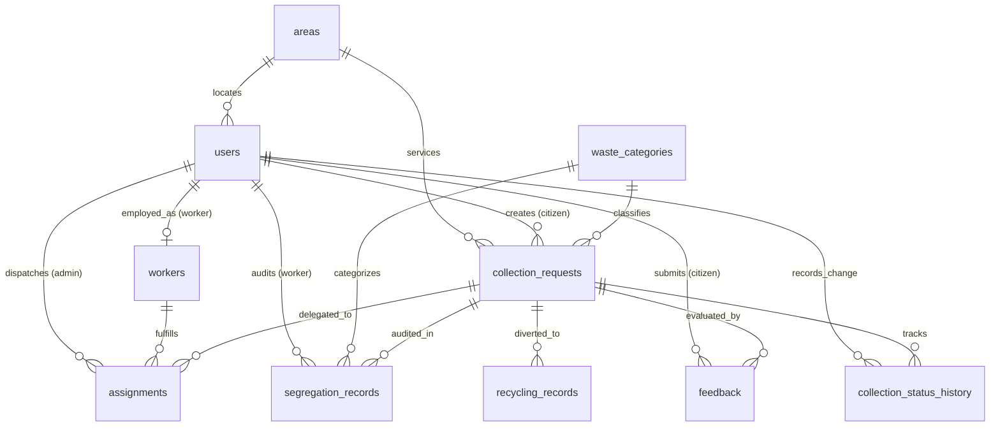

# Database Design Document: Smart Waste Collection & Segregation Tracker

**Database Name:** `smart_waste_db`  
**Target RDBMS:** MySQL 8.0+  
**Storage Engine:** InnoDB (ACID Compliant)  
**Character Set / Collation:** `utf8mb4` / `utf8mb4_unicode_ci`  

---

## 1. Design Overview and Architectural Philosophy

The **Smart Waste Collection & Segregation Tracker** is architected to address urban waste tracking, household segregation compliance, sanitation workforce dispatching, and circular economy recycling audits. The relational database is designed according to strict Boyce-Codd Normal Form (BCNF) / Third Normal Form (3NF) principles to eliminate data redundancy, prevent modification anomalies, and preserve strict referential integrity.

### Core Design Principles:
1. **Separation of Concerns:** Distinct entities represent authentication (`users`), geographic routing (`areas`), waste classification (`waste_categories`), operational workflows (`collection_requests`, `assignments`), auditing (`segregation_records`, `collection_status_history`), processing (`recycling_records`), and quality satisfaction (`feedback`).
2. **Referential Integrity:** Enforced at the relational engine level using Foreign Keys with `ON DELETE RESTRICT` or `ON DELETE CASCADE` appropriately.
3. **Domain & Business Constraints:** Utilization of `CHECK` constraints (e.g., non-negative weights, star rating scale 1–5), `ENUM` data types for finite state lifecycles, and `UNIQUE` constraints to prohibit duplicate active assignments or double-feedback.
4. **Auditability & Traceability:** Lifecycle transitions automatically log into `collection_status_history` via stored procedures and triggers.

---

## 2. Entity-Relationship (ER) Architecture

### Entity List (10 Relational Tables):
1. `areas` — Service neighborhoods and postal codes.
2. `waste_categories` — Master waste categories with instructions and UI hex codes.
3. `users` — Multi-role authentication and demographic master.
4. `workers` — Sanitation employee records and availability states.
5. `collection_requests` — Central transactional table representing citizen pickup orders.
6. `assignments` — Association entity managing worker dispatch.
7. `segregation_records` — Physical waste segregation audits at source.
8. `recycling_records` — Materials recovery and disposal destination logs.
9. `feedback` — Citizen star rating and quality reviews.
10. `collection_status_history` — Comprehensive audit log of all request status transitions.

### Mermaid ER Diagram:

---

## 3. Relationships and Cardinality Matrix

| Parent Entity | Child Entity | Cardinality | Foreign Key Column | Business Rule Description |
| :--- | :--- | :--- | :--- | :--- |
| `areas` | `users` | 1 to Many (1:N) | `users.area_id` | A service area contains many registered citizens; a user can optionally belong to an area (`ON DELETE SET NULL`). |
| `areas` | `collection_requests` | 1 to Many (1:N) | `collection_requests.area_id` | A service area encompasses multiple pickup requests; each pickup request has an explicit pickup area. |
| `users` | `collection_requests` | 1 to Many (1:N) | `collection_requests.citizen_id` | One citizen creates zero or many pickup requests. |
| `users` | `workers` | 1 to 1 (1:1) | `workers.user_id` | An administrative user account with role='worker' has exactly one worker employment profile (`UNIQUE KEY`). |
| `waste_categories` | `collection_requests` | 1 to Many (1:N) | `collection_requests.category_id` | Master categories classify each collection request. |
| `collection_requests` | `assignments` | 1 to Many (1:N) | `assignments.request_id` | A request can have historical assignment attempts, but only one 'Active' assignment at any instant. |
| `workers` | `assignments` | 1 to Many (1:N) | `assignments.worker_id` | A sanitation worker is assigned to multiple pickup requests across their employment tenure. |
| `collection_requests` | `segregation_records` | 1 to Many (1:N) | `segregation_records.request_id` | A single collection request may be split and inspected across distinct waste streams during sorting. |
| `collection_requests` | `recycling_records` | 1 to Many (1:N) | `recycling_records.request_id` | Collected waste from a request is routed to recycling, composting, or treatment facilities. |
| `collection_requests` | `feedback` | 1 to 1 (1:1) | `feedback.request_id` | Each completed collection request allows at most one feedback review per citizen (`UNIQUE KEY (request_id, citizen_id)`). |
| `collection_requests` | `collection_status_history` | 1 to Many (1:N) | `collection_status_history.request_id` | Every lifecycle transition logs a chronological immutable record. |

---

## 4. Comprehensive Data Dictionary

### Table 1: `areas`
Stores geographic collection sectors and postal zoning.
- `area_id` (`INT`, PK, Auto-Increment) — Unique area identifier.
- `area_name` (`VARCHAR(100)`, NOT NULL) — Display name of the area (e.g., 'Green Valley Sector 4').
- `locality` (`VARCHAR(200)`) — Neighborhood landmark or sector details.
- `postal_code` (`VARCHAR(10)`, NOT NULL) — Postal / PIN code.
- `created_at` (`TIMESTAMP`, DEFAULT CURRENT_TIMESTAMP) — Registration timestamp.

### Table 2: `waste_categories`
Master categories specifying segregation rules and UI color identification.
- `category_id` (`INT`, PK, Auto-Increment) — Category primary key.
- `category_name` (`VARCHAR(50)`, UNIQUE, NOT NULL) — Unique category label (Wet/Organic, Dry, Recyclable, Hazardous).
- `description` (`TEXT`) — Detailed definition of waste materials.
- `segregation_instructions` (`TEXT`) — Guidance for citizens on rinsing, sorting, and packaging.
- `color_code` (`VARCHAR(7)`) — Standardized Hex color code (e.g., `#28a745` for green bin).

### Table 3: `users`
Central authentication and identity table across Admin, Citizen, and Worker roles.
- `user_id` (`INT`, PK, Auto-Increment) — User identity primary key.
- `full_name` (`VARCHAR(100)`, NOT NULL) — User's display name.
- `email` (`VARCHAR(100)`, UNIQUE, NOT NULL) — Unique login credential.
- `password_hash` (`VARCHAR(255)`, NOT NULL) — Cryptographic scrypt/pbkdf2 hash.
- `phone` (`VARCHAR(15)`) — Contact phone number.
- `role` (`ENUM('admin', 'citizen', 'worker')`, NOT NULL, DEFAULT 'citizen') — Authorization role.
- `area_id` (`INT`, FK &rarr; `areas.area_id`) — User's primary residential zone.
- `is_active` (`BOOLEAN`, DEFAULT TRUE) — Soft-deletion status flag.
- `created_at` (`TIMESTAMP`, DEFAULT CURRENT_TIMESTAMP) — Account creation timestamp.
- `updated_at` (`TIMESTAMP`, ON UPDATE CURRENT_TIMESTAMP) — Last update timestamp.

### Table 4: `workers`
Operational workforce table tracking employment and dispatch availability.
- `worker_id` (`INT`, PK, Auto-Increment) — Worker identifier.
- `user_id` (`INT`, UNIQUE, FK &rarr; `users.user_id`) — Foreign key to base user account.
- `availability_status` (`ENUM('Available', 'Busy', 'On Leave')`, DEFAULT 'Available') — Dispatch state.
- `joining_date` (`DATE`, NOT NULL) — Date of employment.
- `total_collections` (`INT`, DEFAULT 0) — Cumulative completed collections counter.

### Table 5: `collection_requests`
Primary operational table representing waste collection orders.
- `request_id` (`INT`, PK, Auto-Increment) — Unique request identifier.
- `citizen_id` (`INT`, FK &rarr; `users.user_id`, NOT NULL) — Requesting citizen.
- `category_id` (`INT`, FK &rarr; `waste_categories.category_id`, NOT NULL) — Declared category.
- `area_id` (`INT`, FK &rarr; `areas.area_id`, NOT NULL) — Pickup area location.
- `estimated_quantity_kg` (`DECIMAL(10,2)`, NOT NULL, CHECK > 0) — Citizen-estimated weight.
- `actual_quantity_kg` (`DECIMAL(10,2)`, CHECK >= 0) — Worker-measured weight upon pickup.
- `pickup_address` (`TEXT`, NOT NULL) — Precise street address.
- `preferred_date` (`DATE`, NOT NULL) — Scheduled pickup date.
- `status` (`ENUM('Pending','Assigned','In Progress','Collected','Completed','Cancelled')`, NOT NULL, DEFAULT 'Pending') — Lifecycle status state machine.
- `notes` (`TEXT`) — Citizen pickup notes.
- `created_at` (`TIMESTAMP`, DEFAULT CURRENT_TIMESTAMP) — Submission time.
- `updated_at` (`TIMESTAMP`, ON UPDATE CURRENT_TIMESTAMP) — Last status modification.
- `completed_at` (`DATETIME`) — Completion timestamp.

### Table 6: `assignments`
Worker dispatch association table.
- `assignment_id` (`INT`, PK, Auto-Increment) — Assignment identifier.
- `request_id` (`INT`, FK &rarr; `collection_requests.request_id`, NOT NULL) — Associated pickup.
- `worker_id` (`INT`, FK &rarr; `workers.worker_id`, NOT NULL) — Dispatched worker.
- `assigned_by` (`INT`, FK &rarr; `users.user_id`, NOT NULL) — Admin who authorized dispatch.
- `assigned_at` (`TIMESTAMP`, DEFAULT CURRENT_TIMESTAMP) — Dispatch timestamp.
- `assignment_status` (`ENUM('Active', 'Completed', 'Cancelled')`, DEFAULT 'Active') — State.
- *Constraint:* `UNIQUE KEY unique_active_assignment (request_id, assignment_status)` prevents duplicate concurrent active dispatches.

### Table 7: `segregation_records`
Auditing records verifying source segregation compliance.
- `segregation_id` (`INT`, PK, Auto-Increment) — Audit record ID.
- `request_id` (`INT`, FK &rarr; `collection_requests.request_id`, NOT NULL) — Parent request.
- `category_id` (`INT`, FK &rarr; `waste_categories.category_id`, NOT NULL) — Stream category.
- `quantity_kg` (`DECIMAL(10,2)`, NOT NULL, CHECK >= 0) — Inspected portion weight.
- `is_correctly_segregated` (`BOOLEAN`) — Compliance boolean (TRUE/FALSE/NULL).
- `segregation_status` (`ENUM('Pending', 'Verified', 'Incorrect')`, DEFAULT 'Pending') — Audit state.
- `recorded_by` (`INT`, FK &rarr; `users.user_id`) — Auditing worker/inspector.
- `recorded_at` (`TIMESTAMP`, DEFAULT CURRENT_TIMESTAMP) — Timestamp.
- `remarks` (`TEXT`) — Field notes on contamination or quality.

### Table 8: `recycling_records`
Diversion and processing records.
- `recycling_id` (`INT`, PK, Auto-Increment) — Processing record ID.
- `request_id` (`INT`, FK &rarr; `collection_requests.request_id`, NOT NULL) — Sourced collection.
- `quantity_kg` (`DECIMAL(10,2)`, NOT NULL, CHECK >= 0) — Processed weight.
- `processing_type` (`ENUM('Recycling', 'Composting', 'Landfill', 'Incineration', 'Special Treatment')`, NOT NULL) — Method.
- `destination` (`VARCHAR(200)`) — Name of recycling or composting facility.
- `processed_at` (`TIMESTAMP`, DEFAULT CURRENT_TIMESTAMP) — Batch timestamp.
- `notes` (`TEXT`) — Processing notes.

### Table 9: `feedback`
Citizen quality ratings.
- `feedback_id` (`INT`, PK, Auto-Increment) — Feedback primary key.
- `request_id` (`INT`, FK &rarr; `collection_requests.request_id`, NOT NULL) — Rated pickup.
- `citizen_id` (`INT`, FK &rarr; `users.user_id`, NOT NULL) — Reviewer.
- `rating` (`INT`, NOT NULL, CHECK BETWEEN 1 AND 5) — Star rating.
- `comments` (`TEXT`) — Written feedback.
- `submitted_at` (`TIMESTAMP`, DEFAULT CURRENT_TIMESTAMP) — Submission time.
- *Constraint:* `UNIQUE KEY unique_feedback (request_id, citizen_id)` guarantees single feedback per pickup.

### Table 10: `collection_status_history`
Chronological immutable audit log.
- `history_id` (`INT`, PK, Auto-Increment) — History primary key.
- `request_id` (`INT`, FK &rarr; `collection_requests.request_id`, NOT NULL) — Associated request.
- `previous_status` (`VARCHAR(20)`) — State before change.
- `new_status` (`VARCHAR(20)`, NOT NULL) — State after change.
- `changed_by` (`INT`, FK &rarr; `users.user_id`) — Actor who triggered transition.
- `changed_at` (`TIMESTAMP`, DEFAULT CURRENT_TIMESTAMP) — Timestamp.
- `remarks` (`TEXT`) — Explanation or automated trigger note.

---

## 5. Indexing Strategy & Query Optimization

Indexes are implemented using B-Tree indexing to eliminate full-table scans (`ALL`) in critical operations:

1. `idx_requests_status` on `collection_requests(status)`: Optimizes dashboard queries filtering for `Pending` or `Assigned` requests.
2. `idx_requests_citizen` on `collection_requests(citizen_id)`: Accelerates citizen portal history lookups from $O(N)$ to $O(\log N)$.
3. `idx_requests_preferred_date` on `collection_requests(preferred_date)`: Accelerates daily dispatch route aggregation.
4. `idx_assignments_worker` on `assignments(worker_id)`: Quickly aggregates tasks assigned to a specific worker.
5. `idx_assignments_worker_status` on `assignments(worker_id, assignment_status)`: Compound index optimizing active task queries for worker mobile/dashboard views.
6. `idx_segregation_request` and `idx_recycling_request`: Accelerate nested joins during report generation.

