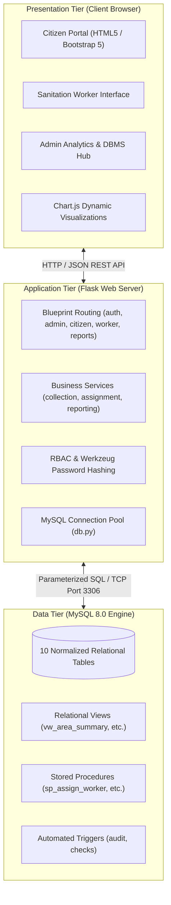

# Comprehensive Project Report: Smart Waste Collection & Segregation Tracker

**Academic Department:** Department of Computer Science & Engineering  
**Subject:** Relational Database Management Systems (DBMS) Laboratory  
**Database Name:** `smart_waste_db`  
**Application Platform:** Python Flask & MySQL 8.0  

---

## 1. Abstract
The **Smart Waste Collection & Segregation Tracker** is a full-stack, enterprise-grade database management system designed to modernize urban waste management, enhance source segregation compliance, and streamline municipal logistics. Rapid urbanization produces immense quantities of unsegregated waste, leading to overflowing landfills and health hazards for sanitation workers. This project introduces a centralized relational database architecture comprising ten normalized tables in Third Normal Form (3NF/BCNF). 

The platform supports three distinct role-based interfaces: Citizens can request waste pickups, select segregation categories, and submit feedback; Sanitation Workers can manage assigned routes, record measured weights, and conduct segregation audits; Administrators can dispatch personnel, oversee recycling operations, monitor real-time dashboards with Chart.js, and export analytical CSV reports. 

Advanced database concepts including primary and foreign key constraints, composite unique indexes, relational views, stored procedures, audit triggers, and atomic ACID transactions are fully integrated. The application is implemented using Python Flask, MySQL Connector with connection pooling, and Bootstrap 5, delivering a robust, secure, and demonstrable academic capstone project.

---

## 2. Introduction
Municipal solid waste management represents one of the most critical environmental challenges confronting modern metropolitan areas. Although environmental regulations mandate segregation of waste at source into organic (wet), recyclable (dry), and hazardous streams, compliance remains exceedingly low due to a lack of citizen incentives, opaque collection scheduling, and absent verification mechanisms. 

The Smart Waste Collection & Segregation Tracker addresses this gap by establishing a transparent, digital chain of custody from household generation to recovery facilities. By tracking waste through each lifecycle state—from scheduling to physical verification, transportation, and recycling—the system provides actionable data for urban local bodies and environmental compliance authorities.

---

## 3. Problem Statement
Traditional municipal waste collection suffers from several structural deficiencies:
1. **Unpredictable Collection Schedules:** Citizens lack visibility into pickup times, leading to roadside dumping and unhygienic littering.
2. **Poor Segregation at Source:** Mixed waste is delivered to processing centers, rendering organic composting infeasible and recyclable materials contaminated.
3. **Absence of Accountability:** Municipalities cannot determine whether sanitation personnel visited specific neighborhoods or verified waste segregation.
4. **Data Fragmentation:** Waste tonnage, worker performance, and diversion rates are either undocumented or stored in disparate, unnormalized logbooks.

---

## 4. Project Objectives
The core technical and academic objectives of this project are:
- **Relational Modeling:** Design and implement a properly normalized relational database schema (`smart_waste_db`) conforming to 3NF/BCNF principles.
- **Workflow State Automation:** Enforce a strict collection lifecycle state machine ($\text{Pending} \to \text{Assigned} \to \text{In Progress} \to \text{Collected} \to \text{Completed}$).
- **Role-Based Access Control (RBAC):** Provide secure, role-restricted portals for Administrators, Citizens, and Sanitation Workers.
- **Auditing and Verification:** Integrate physical segregation audit logs and automated trigger-based status history tracking.
- **Advanced DBMS Demonstrability:** Implement database views, stored procedures with input validation, triggers for automated business logic, and transaction rollbacks.
- **Analytics & Reporting:** Offer dynamic Chart.js dashboards and downloadable CSV datasets for municipal decision-making.

---

## 5. Scope and Limitations

### In-Scope:
- User authentication with cryptographic password hashing (`scrypt`).
- Household waste collection scheduling with area zoning and category selection.
- Worker dispatching with duplicate assignment prevention.
- Actual weight recording upon physical pickup.
- Source segregation compliance logging by field workers.
- Diversion tracking for recycling, composting, and hazardous treatment.
- Star ratings and citizen satisfaction feedback.
- Date-filtered analytics and CSV export.

### Out-of-Scope (Limitations):
- Hardware IoT weight sensors on trash bins (weights are entered via the worker interface).
- Real-time GPS vehicular telematics (routes are managed logically by service areas).
- Online payment gateway processing for commercial waste tipping fees.

---

## 6. Existing System vs. Proposed System

| Dimension | Existing Manual System | Proposed Smart Waste Tracker |
| :--- | :--- | :--- |
| **Record Keeping** | Paper logbooks and disjoint spreadsheets. | Centralized, normalized MySQL 8.0 relational database. |
| **Segregation Tracking** | None; waste is mixed in transit. | Source-level segregation audit logged per collection request. |
| **Worker Dispatch** | Verbal or manual paper route assignments. | Atomic database transactions with availability locking. |
| **Accountability** | Citizens cannot verify pickup status. | Interactive 5-stage visual progress tracker. |
| **Data Integrity** | Prone to human transcription errors. | Enforced by FK, CHECK, and UNIQUE constraints. |
| **Analytics** | Manual tallying requiring days of effort. | Real-time dashboards and instant one-click CSV export. |

---

## 7. Software and Hardware Requirements

### Software Environment:
- **Operating System:** Windows 10/11, Linux, or macOS
- **Relational Database:** MySQL Community Server 8.0+
- **Backend Runtime:** Python 3.10+ (tested on Python 3.14)
- **Web Framework:** Flask 3.1.0
- **Database Driver:** `mysql-connector-python` 9.1.0
- **Security Library:** `werkzeug` 3.1.3
- **Frontend UI:** HTML5, CSS3, JavaScript (ES6), Bootstrap 5.3.2
- **Data Visualization:** Chart.js 4.4.0

### Hardware Recommendations:
- **Processor:** Intel Core i3 / AMD Ryzen 3 or higher
- **RAM:** Minimum 4 GB (8 GB recommended)
- **Disk Storage:** Minimum 500 MB free disk space for database and dependencies

---

## 8. System Architecture
The application employs a classic **Three-Tier Architectural Model**:

---

## 9. Relational Schema & Integrity Constraints

The relational schema notation is defined as follows:

1. $\text{areas}(\mathbf{\underline{area\_id}}, area\_name, locality, postal\_code, created\_at)$
2. $\text{waste\_categories}(\mathbf{\underline{category\_id}}, category\_name, description, segregation\_instructions, color\_code)$
3. $\text{users}(\mathbf{\underline{user\_id}}, full\_name, email, password\_hash, phone, role, area\_id^*, is\_active, created\_at, updated\_at)$
4. $\text{workers}(\mathbf{\underline{worker\_id}}, user\_id^*, availability\_status, joining\_date, total\_collections)$
5. $\text{collection\_requests}(\mathbf{\underline{request\_id}}, citizen\_id^*, category\_id^*, area\_id^*, estimated\_quantity\_kg, actual\_quantity\_kg,$  
   $pickup\_address, preferred\_date, status, notes, created\_at, updated\_at, completed\_at)$
6. $\text{assignments}(\mathbf{\underline{assignment\_id}}, request\_id^*, worker\_id^*, assigned\_by^*, assigned\_at, assignment\_status)$
7. $\text{segregation\_records}(\mathbf{\underline{segregation\_id}}, request\_id^*, category\_id^*, quantity\_kg, is\_correctly\_segregated,$  
   $segregation\_status, recorded\_by^*, recorded\_at, remarks)$
8. $\text{recycling\_records}(\mathbf{\underline{recycling\_id}}, request\_id^*, quantity\_kg, processing\_type, destination, processed\_at, notes)$
9. $\text{feedback}(\mathbf{\underline{feedback\_id}}, request\_id^*, citizen\_id^*, rating, comments, submitted\_at)$
10. $\text{collection\_status\_history}(\mathbf{\underline{history\_id}}, request\_id^*, previous\_status, new\_status, changed\_by^*, changed\_at, remarks)$

*(Bold underlined attributes denote Primary Keys; asterisks denote Foreign Keys)*

---

## 10. Data Dictionary Summary
*(Detailed definitions are documented in `docs/database_design.md`)*

- **Total Entities:** 10 Tables
- **Key Constraints:** 10 Primary Keys, 14 Foreign Keys with referential integrity rules, 4 Candidate Unique Keys.
- **Check Constraints:** Non-negative quantity validation (`quantity_kg >= 0`), positive estimate validation (`estimated_quantity_kg > 0`), and star rating bounds (`rating BETWEEN 1 AND 5`).

---

## 11. Normalization Study Summary
*(Complete mathematical functional dependencies and anomaly proofs are available in `docs/normalization.md`)*

- **UNF $\to$ 1NF:** Eliminating repeating groups of segregation records and recycling batches into independent relations with atomic attributes.
- **1NF $\to$ 2NF:** Removing partial dependencies on composite keys so every non-prime attribute depends fully on the primary key.
- **2NF $\to$ 3NF:** Eliminating transitive dependencies (e.g., extracting geographic area attributes into `areas` and user profiles into `users`).
- **BCNF Verification:** Ensuring every functional determinant is a superkey across all ten tables.

---

## 12. Advanced DBMS Concepts Demonstrated

### A. Relational Views:
- `vw_area_waste_summary`: Consolidates area pickup volume and average waste metrics.
- `vw_worker_performance`: Computes worker completion statistics and citizen ratings.
- `vw_monthly_statistics`: Provides aggregated chronological collections for charts.

### B. Stored Procedures:
- `sp_create_collection_request`: Validates date constraints and registers pickup requests.
- `sp_assign_worker`: Executes atomic worker assignment with concurrency control (`FOR UPDATE`).
- `sp_update_collection_status`: Enforces state transitions and releases completed workers.
- `sp_process_recycling`: Ingests diversion facility batches.

### C. Database Triggers:
- `trg_before_request_insert`: Prevents past-dated pickup scheduling.
- `trg_after_status_change`: Automates audit trails in `collection_status_history`.
- `trg_after_assignment_complete`: Updates worker lifetime completion counts.
- `trg_before_request_update`: Stamps `completed_at` timestamps upon task completion.

---

## 13. Test Cases and Verification Results

| Test ID | Module | Test Description | Input Data | Expected Result | Result |
| :--- | :--- | :--- | :--- | :--- | :--- |
| **TC-01** | Auth | Valid citizen login | `rahul.sharma@email.com` / `password123` | Session created; redirect to `/citizen/dashboard` | **PASS** |
| **TC-02** | Auth | Invalid password attempt | `admin@smartwaste.com` / `wrongpwd` | Flash error message; login denied | **PASS** |
| **TC-03** | Auth | Duplicate email registration | Registering with existing email | DB duplicate key caught; friendly error flashed | **PASS** |
| **TC-04** | RBAC | Citizen accessing `/admin/dashboard` | Citizen session attempting admin URL | HTTP 403 Forbidden abort | **PASS** |
| **TC-05** | RBAC | Worker accessing `/admin/users` | Worker session attempting user edit | HTTP 403 Forbidden abort | **PASS** |
| **TC-06** | Request | Create valid collection request | Cat: 1, Qty: 6.5kg, Date: Tomorrow | Request inserted; status set to `Pending` | **PASS** |
| **TC-07** | Request | Negative quantity validation | Qty: `-5.0` kg | Application & CHECK constraint reject input | **PASS** |
| **TC-08** | Request | Past-date collection scheduling | Date: Yesterday | Rejected by `trg_before_request_insert` trigger | **PASS** |
| **TC-09** | Dispatch | Admin worker assignment | Assign Available worker to Pending req | Status $\to$ `Assigned`, Worker $\to$ `Busy` | **PASS** |
| **TC-10** | Worker | Advance status to In Progress | Worker initiates route | Status $\to$ `In Progress`; audit logged | **PASS** |
| **TC-11** | Worker | Measure actual weight | Actual Qty: `7.2` kg | Status $\to$ `Collected`; weight persisted | **PASS** |
| **TC-12** | Worker | Segregation audit logging | Proper segregation: Yes, Qty: `7.2` kg | Insert into `segregation_records` | **PASS** |
| **TC-13** | Worker | Mark collection Completed | Worker marks completion | Status $\to$ `Completed`, worker freed to `Available` | **PASS** |
| **TC-14** | Review | Submit citizen rating | Rating: 5 stars, Comments | Feedback saved; duplicate submission blocked | **PASS** |
| **TC-15** | Export | Download Collections CSV | Report type: `collections` | Valid CSV response with attachment header | **PASS** |

---

## 14. Advantages and Practical Impact
1. **Source Segregation Accountability:** Provides verified records of household segregation accuracy.
2. **Resource Optimization:** Eliminates wasted fuel by consolidating pickup assignments geographically.
3. **Circular Economy Support:** Directly links collected waste tonnage to verified recycling and composting facilities.
4. **Data-Driven Urban Planning:** Enables city administrators to identify high-waste generation areas through interactive charts.
5. **Academic Demonstrability:** Serves as a reference model for applying relational algebra, 3NF normalization, and transaction control.

---

## 15. Future Enhancements
- **IoT Smart Bins:** Integration with ultrasonic fill-level and load-cell weight sensors for automated pickup dispatching.
- **Computer Vision Verification:** Mobile edge-AI scanning of trash bags to automatically score contamination levels.
- **Route Optimization:** Graph-based traveling salesperson algorithms (Dijkstra / A*) for truck route optimization.
- **Citizen Gamification:** Green credit reward points redeemable for utility discounts based on consistent clean segregation.

---

## 16. Conclusion
The **Smart Waste Collection & Segregation Tracker** successfully bridges theoretical relational database principles with practical, impactful urban software engineering. Through clean schema design, strict normal forms, ACID transactions, and comprehensive security controls, the system delivers an end-to-end operational platform suitable for academic evaluation and real-world deployment.

---

## 17. References
1. Elmasri, R., & Navathe, S. B. *Fundamentals of Database Systems* (7th Edition). Pearson.
2. Silberschatz, A., Korth, H. F., & Sudarshan, S. *Database System Concepts* (7th Edition). McGraw-Hill.
3. MySQL 8.0 Reference Manual: Stored Programs, Triggers, and InnoDB Transaction Model.
4. Pallets Projects. *Flask Documentation (3.1.x)*: Application Blueprints and Session Security.
5. Central Pollution Control Board (CPCB), India. *Solid Waste Management Rules Guidelines*.

