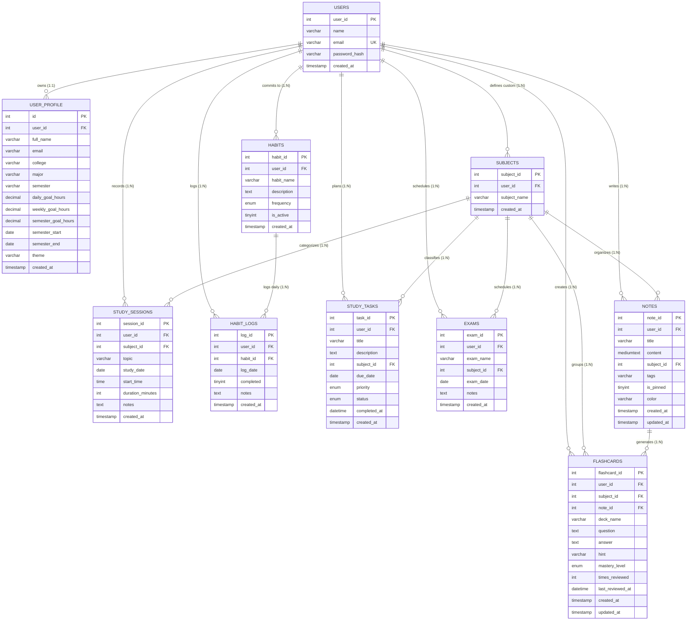

# TrackMate — Database Architecture & DBMS Specification

**Course**: Second-Year B.E. Computer Science and Business Systems  
**Subject**: Database Management Systems (DBMS Mini-Project)  
**Database Engine**: MySQL 8.0+ / InnoDB Storage Engine  
**Character Set**: `utf8mb4` | **Collation**: `utf8mb4_unicode_ci`  
**Database Name**: `trackmate_db`  

---

## 1. Entity-Relationship (ER) Diagram



---

## 2. Relational Schema & Table Specifications

### 2.0 Table: `users`
Central student account entity providing cryptographic authentication and per-user data tenancy.
* **Primary Key**: `user_id` (INT AUTO_INCREMENT)
* **Unique Key**: `email` (VARCHAR(191) UNIQUE)
* **Indexes**: `PRIMARY KEY (user_id)`, `UNIQUE KEY uq_users_email (email)`

| Column | Data Type | Nullable | Key | Default | Description |
|---|---|---|---|---|---|
| `user_id` | INT | NO | PK | AUTO_INCREMENT | Unique student account identifier |
| `name` | VARCHAR(120) | NO | None | None | Student's full legal or preferred name |
| `email` | VARCHAR(191) | NO | UNI | None | Student email address (unique login credential) |
| `password_hash` | VARCHAR(255) | NO | None | None | Cryptographic PBKDF2:SHA256 salted password hash |
| `created_at` | TIMESTAMP | YES | None | CURRENT_TIMESTAMP | Account creation timestamp |

---

### 2.1 Table: `Subjects`
Stores academic courses and subject entities.
* **Primary Key**: `subject_id` (INT AUTO_INCREMENT)
* **Foreign Key**: `user_id` REFERENCES `users(user_id)` ON DELETE SET NULL (NULL = standard curriculum subject)

---

### 2.2 Table: `Study_Sessions`
Stores actual deep work intervals recorded by the student.
* **Primary Key**: `session_id` (INT AUTO_INCREMENT)
* **Foreign Key**: `subject_id` REFERENCES `Subjects(subject_id)` ON DELETE CASCADE ON UPDATE CASCADE
* **Indexes**: `idx_sessions_date(study_date)`, `idx_sessions_subject(subject_id)`

| Column | Data Type | Nullable | Key | Default | Description |
|---|---|---|---|---|---|
| `session_id` | INT | NO | PK | AUTO_INCREMENT | Primary record identifier |
| `subject_id` | INT | NO | FK | None | Linked subject |
| `topic` | VARCHAR(255) | NO | None | None | Topic or concept studied |
| `study_date` | DATE | NO | MUL | None | Calendar date of session |
| `start_time` | TIME | YES | None | NULL | Clock start time |
| `duration_minutes`| INT | NO | None | None | Duration in whole minutes (> 0) |
| `notes` | TEXT | YES | None | NULL | Formulas, exercises, notes |
| `created_at` | TIMESTAMP | YES | None | CURRENT_TIMESTAMP | Audit timestamp |

---

### 2.3 Table: `Habits`
Stores personal and academic daily habits.
* **Primary Key**: `habit_id` (INT AUTO_INCREMENT)
* **Unique Key**: `habit_name` (VARCHAR(150))

| Column | Data Type | Nullable | Key | Default | Description |
|---|---|---|---|---|---|
| `habit_id` | INT | NO | PK | AUTO_INCREMENT | Habit identifier |
| `habit_name` | VARCHAR(150) | NO | UNI | None | Name of routine |
| `description` | TEXT | YES | None | NULL | Optional objective/instruction |
| `frequency` | ENUM('Daily','Weekly') | NO | None | 'Daily' | Target cadence |
| `is_active` | TINYINT(1) | NO | None | 1 | 1 = Active, 0 = Archived |
| `created_at` | TIMESTAMP | YES | None | CURRENT_TIMESTAMP | Audit timestamp |

---

### 2.4 Table: `Habit_Logs`
Stores daily completion check-offs.
* **Primary Key**: `log_id` (INT AUTO_INCREMENT)
* **Foreign Key**: `habit_id` REFERENCES `Habits(habit_id)` ON DELETE CASCADE ON UPDATE CASCADE
* **Unique Constraint**: `CONSTRAINT uq_habit_date UNIQUE (habit_id, log_date)`
  - *Prevents multiple rows for the same habit on the same day; allows idempotent upserts.*
* **Index**: `idx_habit_logs_date(log_date)`

| Column | Data Type | Nullable | Key | Default | Description |
|---|---|---|---|---|---|
| `log_id` | INT | NO | PK | AUTO_INCREMENT | Log entry ID |
| `habit_id` | INT | NO | FK | None | Reference to habit |
| `log_date` | DATE | NO | MUL | None | Calendar date |
| `completed` | TINYINT(1) | NO | None | 0 | 1 = Complete, 0 = Incomplete |
| `notes` | TEXT | YES | None | NULL | Daily reflection / notes |
| `created_at` | TIMESTAMP | YES | None | CURRENT_TIMESTAMP | Audit timestamp |

---

### 2.5 Table: `user_profile`
Maintains user preferences, academic majors, and study goals.
* **Primary Key**: `id` (INT DEFAULT 1)

| Column | Data Type | Nullable | Key | Default | Description |
|---|---|---|---|---|---|
| `id` | INT | NO | PK | 1 | Singleton profile record |
| `full_name` | VARCHAR(100) | YES | None | 'Alex Morgan' | Student name |
| `email` | VARCHAR(120) | YES | None | 'alex.morgan@...' | Student contact email |
| `college` | VARCHAR(150) | YES | None | 'Faculty of Eng...' | College / Department |
| `major` | VARCHAR(100) | YES | None | 'Computer Science'| Academic branch |
| `semester` | VARCHAR(50) | YES | None | 'Semester 5' | Academic semester |
| `daily_goal_hours` | DECIMAL(4,1) | YES | None | 4.0 | Daily focus target |
| `weekly_goal_hours`| DECIMAL(4,1) | YES | None | 25.0 | Weekly focus target |
| `semester_goal_hours`| DECIMAL(6,1)| YES | None | 300.0 | Semester total goal |
| `semester_start` | DATE | YES | None | NULL | Term start date |
| `semester_end` | DATE | YES | None | NULL | Term conclusion date |
| `theme` | VARCHAR(20) | YES | None | 'dark' | Theme preference |
| `created_at` | TIMESTAMP | YES | None | CURRENT_TIMESTAMP | Audit timestamp |

---

### 2.6 Table: `Study_Tasks` (Planner)
Stores planned coursework, assignments, and backlog items.
* **Primary Key**: `task_id` (INT AUTO_INCREMENT)
* **Foreign Key**: `subject_id` REFERENCES `Subjects(subject_id)` ON DELETE SET NULL ON UPDATE CASCADE
* **Indexes**: `idx_tasks_due_date(due_date)`, `idx_tasks_status(status)`

---

### 2.7 Table: `Exams`
Stores official examination dates and syllabi.
* **Primary Key**: `exam_id` (INT AUTO_INCREMENT)
* **Foreign Key**: `subject_id` REFERENCES `Subjects(subject_id)` ON DELETE SET NULL ON UPDATE CASCADE
* **Index**: `idx_exams_date(exam_date)`

---

### 2.8 Table: `Notes`
Stores revision notes, markdown summaries, and cheat sheets.
* **Primary Key**: `note_id` (INT AUTO_INCREMENT)
* **Foreign Key**: `subject_id` REFERENCES `Subjects(subject_id)` ON DELETE SET NULL ON UPDATE CASCADE

---

### 2.9 Table: `Flashcards`
Spaced repetition cards linked to subjects and notes.
* **Primary Key**: `flashcard_id` (INT AUTO_INCREMENT)
* **Foreign Keys**:
  - `subject_id` REFERENCES `Subjects(subject_id)` ON DELETE SET NULL
  - `note_id` REFERENCES `Notes(note_id)` ON DELETE SET NULL

---

## 3. Database Normalization Analysis

TrackMate was designed following formal relational normalization principles up to **Boyce-Codd Normal Form (BCNF)**:

### First Normal Form (1NF)
1. **Atomic Attributes**: All columns contain indivisible values. Multi-valued fields (such as study session notes or flashcard reviews) are not stored as comma-delimited strings inside `Subjects`.
2. **Defined Primary Keys**: Each table possesses a well-defined integer surrogate primary key (`session_id`, `habit_id`, `task_id`).
3. **No Repeating Groups**: Daily logs are modeled in the separate relation `Habit_Logs` rather than having columns like `day1_done, day2_done, day3_done` inside `Habits`.

### Second Normal Form (2NF)
1. The relations are in 1NF.
2. In all tables with simple surrogate primary keys (`session_id`, `habit_id`), every non-key attribute is **fully functionally dependent** on the primary key.
3. In `Habit_Logs`, where the candidate key is `(habit_id, log_date)`, the non-key attributes `completed` and `notes` depend on the whole composite pair, eliminating partial dependencies.

### Third Normal Form (3NF)
1. The relations are in 2NF.
2. **No Transitive Dependencies**: For example, in `Study_Sessions`, only `subject_id` is stored. Subject metadata (such as `subject_name`) is retrieved via relational `JOIN` rather than duplicated in `Study_Sessions`. Thus, $X \rightarrow Y \rightarrow Z$ dependencies are eliminated.

### Boyce-Codd Normal Form (BCNF)
1. For every non-trivial functional dependency $X \rightarrow Y$, $X$ is a superkey:
   - In `Subjects`: `subject_id` $\rightarrow$ `subject_name` and `subject_name` $\rightarrow$ `subject_id` (both are superkeys due to UNIQUE constraints).
   - In `Habits`: `habit_id` $\rightarrow$ `(habit_name, description, frequency)` and `habit_name` $\rightarrow$ `habit_id` (both are superkeys).
   - In `Habit_Logs`: `(habit_id, log_date)` $\rightarrow$ `(completed, notes)` where `(habit_id, log_date)` is a superkey.

---

## 4. Key DBMS Queries & Relational Operations

### Query 1: Subject-Wise Study Duration & Aggregations
Uses `LEFT OUTER JOIN` and `GROUP BY` to aggregate total minutes and hours per course while guaranteeing that subjects with zero sessions are still returned:
```sql
SELECT
    s.subject_id,
    s.subject_name,
    COUNT(ss.session_id) AS total_sessions,
    COALESCE(SUM(ss.duration_minutes), 0) AS total_minutes,
    ROUND(COALESCE(SUM(ss.duration_minutes), 0) / 60, 2) AS total_hours
FROM Subjects s
LEFT JOIN Study_Sessions ss
    ON s.subject_id = ss.subject_id
GROUP BY s.subject_id, s.subject_name
ORDER BY total_minutes DESC;
```

### Query 2: Daily Habit Completion Percentage
Calculates adherence dynamically for any given date using `CASE` aggregation:
```sql
SELECT
    COUNT(h.habit_id) AS total_habits,
    COALESCE(SUM(CASE WHEN hl.completed = 1 THEN 1 ELSE 0 END), 0) AS completed_habits,
    COUNT(h.habit_id) - COALESCE(SUM(CASE WHEN hl.completed = 1 THEN 1 ELSE 0 END), 0) AS remaining_habits,
    ROUND(
        COALESCE(SUM(CASE WHEN hl.completed = 1 THEN 1 ELSE 0 END), 0) * 100.0 /
        NULLIF(COUNT(h.habit_id), 0),
        2
    ) AS completion_percentage
FROM Habits h
LEFT JOIN Habit_Logs hl
    ON h.habit_id = hl.habit_id
    AND hl.log_date = CURDATE()
WHERE h.is_active = TRUE;
```

### Query 3: Seven-Day Productivity Grouping
Groups sessions by date across a sliding 7-day calendar window:
```sql
SELECT
    study_date,
    COUNT(session_id) AS total_sessions,
    SUM(duration_minutes) AS total_minutes,
    ROUND(SUM(duration_minutes) / 60, 2) AS total_hours
FROM Study_Sessions
WHERE study_date >= DATE_SUB(CURDATE(), INTERVAL 6 DAY)
  AND study_date <= CURDATE()
GROUP BY study_date
### Query 4: Per-User Scoped Study Duration (Multi-Tenant Isolation)
Enforces cryptographic and logical isolation so Student A never sees Student B's study records:
```sql
SELECT
    s.subject_id,
    s.subject_name,
    COUNT(ss.session_id) AS total_sessions,
    COALESCE(SUM(ss.duration_minutes), 0) AS total_minutes,
    ROUND(COALESCE(SUM(ss.duration_minutes), 0) / 60, 2) AS total_hours
FROM Subjects s
LEFT JOIN Study_Sessions ss
    ON s.subject_id = ss.subject_id AND ss.user_id = %s
WHERE s.user_id = %s OR s.user_id IS NULL
GROUP BY s.subject_id, s.subject_name
ORDER BY total_minutes DESC;
```

---

## 5. Safe Migration vs. Fresh Database Setup

### Option A: Fresh Database Installation
Run this only if you are initializing TrackMate on a new computer or blank MySQL server:
```powershell
# In Windows PowerShell:
Get-Content sql\schema.sql | mysql -u root -p
```

### Option B: Safe Migration for an Existing Database (Zero Data Loss)
Run this when upgrading an existing database with historical records to the Multi-User Authentication schema:
```powershell
# In Windows PowerShell:
Get-Content sql\migrations\02_multi_user_auth_migration.sql | mysql -u root -p
```
**Migration Guarantees**:
1. Checks `information_schema.tables` before creating `users` table.
2. Checks `information_schema.columns` before executing `ALTER TABLE ... ADD COLUMN user_id`.
3. Seeds default user `alex@trackmate.edu` (password `alex123` via PBKDF2:SHA256) if no user exists.
4. Backfills legacy orphaned rows to `user_id = 1` so zero historical sessions or habits are deleted.
5. Adds foreign key constraints with safe conditional procedures.
