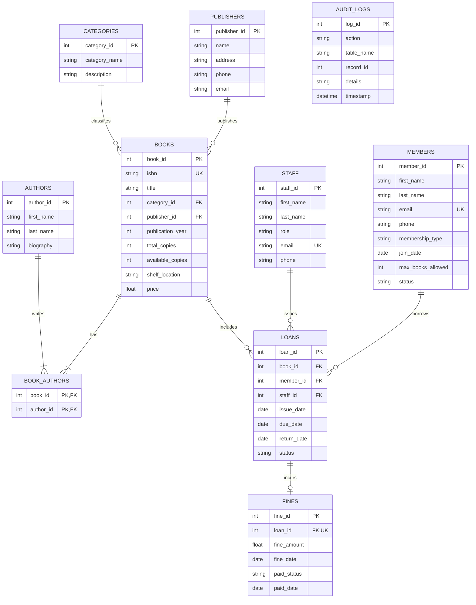

# 📖 DATABASE MANAGEMENT SYSTEMS (DBMS) PROJECT REPORT
## Subject: Database Management Systems (CS / IT / IS)
## Project Title: Relational Library Management System (LMS)

---

## 📑 TABLE OF CONTENTS
1. [Executive Summary & Abstract](#1-executive-summary--abstract)
2. [Problem Statement & Objectives](#2-problem-statement--objectives)
3. [Entity-Relationship (ER) Modeling](#3-entity-relationship-er-modeling)
   - [3.1 Entities and Attributes](#31-entities-and-attributes)
   - [3.2 Relationship Types and Cardinalities](#32-relationship-types-and-cardinalities)
   - [3.3 Mermaid Entity-Relationship Diagram](#33-mermaid-entity-relationship-diagram)
4. [Relational Schema Mapping](#4-relational-schema-mapping)
5. [Database Normalization Analysis](#5-database-normalization-analysis)
   - [5.1 Functional Dependencies (FDs)](#51-functional-dependencies-fds)
   - [5.2 1NF, 2NF, 3NF, and BCNF Proofs](#52-1nf-2nf-3nf-and-bcnf-proofs)
6. [Relational Algebra Expressions](#6-relational-algebra-expressions)
7. [Physical Database Design & Implementation](#7-physical-database-design--implementation)
   - [7.1 Integrity Constraints](#71-integrity-constraints)
   - [7.2 Indexes for Performance Optimization](#72-indexes-for-performance-optimization)
   - [7.3 Automated SQL Triggers](#73-automated-sql-triggers)
   - [7.4 Virtual Views](#74-virtual-views)
8. [Transaction Management & ACID Enforcement](#8-transaction-management--acid-enforcement)
9. [Advanced SQL Queries Showcase](#9-advanced-sql-queries-showcase)
10. [DBMS Lab Viva Voce Questions & Answers (20 Q&As)](#10-dbms-lab-viva-voce-questions--answers)

---

## 1. Executive Summary & Abstract

The **Library Management System (LMS)** is an end-to-end relational database application designed to automate cataloging, member account administration, circulation (book issuing and returns), and penalty (fines) tracking. 

Built in strict compliance with ANSI SQL standards, this system addresses the classical database pitfalls of flat-file and manual book registries—such as data redundancy, update anomalies, referential inconsistencies, and loss of concurrency control. The database enforces **Boyce-Codd Normal Form (BCNF)**, uses automated database triggers to maintain real-time inventory counts and audit trails, and encapsulates transactions with full **ACID (Atomicity, Consistency, Isolation, Durability)** compliance.

---

## 2. Problem Statement & Objectives

### 2.1 Problem Statement
Traditional and semi-automated libraries suffer from:
1. **Redundant Records**: Multiple authors and repeated book copies stored across unnormalized spreadsheets.
2. **Data Inconsistencies**: A book marked as available when it has actually been issued to a patron.
3. **Overdue Calculation Errors**: Manual inspection of return dates leading to inaccurate penalty assessments.
4. **Lack of Referential Integrity**: Deleting a publisher or member record leaving orphan loan records.

### 2.2 Objectives
- Construct an optimal relational schema that eliminates modification anomalies.
- Implement foreign key constraints with explicit `ON DELETE CASCADE` and `ON DELETE RESTRICT` behaviors.
- Enforce business logic directly within the DBMS layer using triggers and check constraints.
- Provide fast query execution through B-Tree indexing.
- Provide a dual interface (Web UI & Console CLI) for academic demonstration and verification.

---

## 3. Entity-Relationship (ER) Modeling

### 3.1 Entities and Attributes
- **Publishers**: `publisher_id` (PK), `name` (Unique), `address`, `phone`, `email`.
- **Categories**: `category_id` (PK), `category_name` (Unique), `description`.
- **Authors**: `author_id` (PK), `first_name`, `last_name`, `biography`.
- **Books**: `book_id` (PK), `isbn` (Unique), `title`, `publication_year`, `total_copies`, `available_copies`, `shelf_location`, `price`.
- **Members**: `member_id` (PK), `first_name`, `last_name`, `email` (Unique), `phone`, `membership_type`, `join_date`, `max_books_allowed`, `status`.
- **Staff**: `staff_id` (PK), `first_name`, `last_name`, `role`, `email` (Unique), `phone`.
- **Loans**: `loan_id` (PK), `issue_date`, `due_date`, `return_date`, `status`.
- **Fines**: `fine_id` (PK), `fine_amount`, `fine_date`, `paid_status`, `paid_date`.
- **Audit Logs**: `log_id` (PK), `action`, `table_name`, `record_id`, `details`, `timestamp`.

### 3.2 Relationship Types and Cardinalities
1. **Books to Categories ($N:1$)**: Many books belong to exactly one category; each category contains one or more books.
2. **Books to Publishers ($N:1$)**: Many books are published by one publisher; a publisher may publish zero or more books.
3. **Books to Authors ($M:N$)**: A book can be written by multiple authors (e.g., CLRS has 4 authors); an author can write multiple books. Decomposed via bridge table `book_authors`.
4. **Members to Loans ($1:N$)**: One member can have multiple loan records over time; each loan record belongs to exactly one member.
5. **Books to Loans ($1:N$)**: One book title can appear in multiple historical loans; each loan record references a specific book.
6. **Loans to Fines ($1:1$)**: An overdue loan produces at most one fine record.

### 3.3 Mermaid Entity-Relationship Diagram



---

## 4. Relational Schema Mapping

The conceptual ER model maps into the following relational database schema:

1. **PUBLISHERS** ($\underline{\text{publisher\_id}}$, name, address, phone, email)
2. **CATEGORIES** ($\underline{\text{category\_id}}$, category\_name, description)
3. **AUTHORS** ($\underline{\text{author\_id}}$, first\_name, last\_name, biography)
4. **BOOKS** ($\underline{\text{book\_id}}$, isbn, title, $\text{category\_id}^*$, $\text{publisher\_id}^*$, publication\_year, total\_copies, available\_copies, shelf\_location, price)
   - Foreign Key: $\text{category\_id} \rightarrow \text{CATEGORIES}(\text{category\_id})$
   - Foreign Key: $\text{publisher\_id} \rightarrow \text{PUBLISHERS}(\text{publisher\_id})$
5. **BOOK\_AUTHORS** ($\underline{\text{book\_id}^*, \text{author\_id}^*}$)
   - Foreign Key: $\text{book\_id} \rightarrow \text{BOOKS}(\text{book\_id})$
   - Foreign Key: $\text{author\_id} \rightarrow \text{AUTHORS}(\text{author\_id})$
6. **MEMBERS** ($\underline{\text{member\_id}}$, first\_name, last\_name, email, phone, membership\_type, join\_date, max\_books\_allowed, status)
7. **STAFF** ($\underline{\text{staff\_id}}$, first\_name, last\_name, role, email, phone)
8. **LOANS** ($\underline{\text{loan\_id}}$, $\text{book\_id}^*$, $\text{member\_id}^*$, $\text{staff\_id}^*$, issue\_date, due\_date, return\_date, status)
   - Foreign Key: $\text{book\_id} \rightarrow \text{BOOKS}(\text{book\_id})$
   - Foreign Key: $\text{member\_id} \rightarrow \text{MEMBERS}(\text{member\_id})$
   - Foreign Key: $\text{staff\_id} \rightarrow \text{STAFF}(\text{staff\_id})$
9. **FINES** ($\underline{\text{fine\_id}}$, $\text{loan\_id}^*$, fine\_amount, fine\_date, paid\_status, paid\_date)
   - Foreign Key: $\text{loan\_id} \rightarrow \text{LOANS}(\text{loan\_id})$
10. **AUDIT\_LOGS** ($\underline{\text{log\_id}}$, action, table\_name, record\_id, details, timestamp)

*(Note: Underlined fields represent Primary Keys; asterisks represent Foreign Keys).*

---

## 5. Database Normalization Analysis

### 5.1 Functional Dependencies (FDs)
- **Books**:
  - $\text{book\_id} \rightarrow \{\text{isbn}, \text{title}, \text{category\_id}, \text{publisher\_id}, \text{publication\_year}, \text{total\_copies}, \text{available\_copies}, \text{shelf\_location}, \text{price}\}$
  - $\text{isbn} \rightarrow \{\text{book\_id}, \text{title}, \text{category\_id}, \text{publisher\_id}, \text{publication\_year}, \text{total\_copies}, \text{available\_copies}, \text{shelf\_location}, \text{price}\}$
- **Categories**:
  - $\text{category\_id} \rightarrow \{\text{category\_name}, \text{description}\}$
- **Publishers**:
  - $\text{publisher\_id} \rightarrow \{\text{name}, \text{address}, \text{phone}, \text{email}\}$
- **Members**:
  - $\text{member\_id} \rightarrow \{\text{first\_name}, \text{last\_name}, \text{email}, \text{phone}, \text{membership\_type}, \text{join\_date}, \text{max\_books\_allowed}, \text{status}\}$
- **Loans**:
  - $\text{loan\_id} \rightarrow \{\text{book\_id}, \text{member\_id}, \text{staff\_id}, \text{issue\_date}, \text{due\_date}, \text{return\_date}, \text{status}\}$
- **Fines**:
  - $\text{fine\_id} \rightarrow \{\text{loan\_id}, \text{fine\_amount}, \text{fine\_date}, \text{paid\_status}, \text{paid\_date}\}$
  - $\text{loan\_id} \rightarrow \{\text{fine\_id}, \text{fine\_amount}, \text{fine\_date}, \text{paid\_status}, \text{paid\_date}\}$

### 5.2 1NF, 2NF, 3NF, and BCNF Proofs

#### First Normal Form (1NF):
- **Condition**: All attribute domains contain only atomic, indivisible values, and there are no repeating groups.
- **Enforcement**: In unnormalized systems, authors were stored as a comma-separated string (e.g., `"Cormen, Leiserson, Rivest, Stein"`). This violated 1NF. In our schema, the multi-valued attribute was extracted into an independent `AUTHORS` relation and connected via `BOOK_AUTHORS`. Hence, the schema is in **1NF**.

#### Second Normal Form (2NF):
- **Condition**: The relation is in 1NF and contains no partial dependencies (no non-prime attribute is functionally dependent on a proper subset of any candidate key).
- **Enforcement**: The only composite candidate key exists in `BOOK_AUTHORS` (`book_id`, `author_id`). Neither attribute holds non-prime attributes in this table. All non-prime attributes in other tables depend on their single-attribute primary keys. Hence, the schema is in **2NF**.

#### Third Normal Form (3NF):
- **Condition**: The relation is in 2NF and no transitive dependency exists (no non-prime attribute is transitively dependent on a candidate key, i.e., for every $X \rightarrow Y$, either $X$ is a superkey or $Y$ is a prime attribute).
- **Enforcement**: Publisher details (`publisher_name`, `publisher_address`) are not kept in `BOOKS` (which would cause $\text{book\_id} \rightarrow \text{publisher\_id} \rightarrow \text{publisher\_name}$). Instead, publishers reside in their own table. Thus, no transitive dependencies exist. The schema is in **3NF**.

#### Boyce-Codd Normal Form (BCNF):
- **Condition**: For every non-trivial functional dependency $X \rightarrow Y$, the determinant $X$ must be a superkey.
- **Enforcement**: In every relation in our design, the left-hand side of all non-trivial functional dependencies is a candidate key (`book_id`, `isbn`, `member_id`, `email`, etc.). Hence, our database achieves **BCNF**.

---

## 6. Relational Algebra Expressions

### 1. Find all active members:
$$\sigma_{\text{status} = 'Active'}(\text{MEMBERS})$$

### 2. Retrieve titles of all books in the 'Database Systems' category:
$$\pi_{\text{title}}\left(\text{BOOKS} \bowtie_{(\text{BOOKS.category\_id} = \text{CATEGORIES.category\_id})} \sigma_{\text{category\_name} = 'Database Systems'}(\text{CATEGORIES})\right)$$

### 3. Find members who have never borrowed any book (Relational Difference):
$$\pi_{\text{member\_id}}(\text{MEMBERS}) - \pi_{\text{member\_id}}(\text{LOANS})$$

### 4. Find books with zero available copies:
$$\pi_{\text{book\_id}, \text{title}}\left(\sigma_{\text{available\_copies} = 0}(\text{BOOKS})\right)$$

### 5. Count total books borrowed per member (Grouping & Aggregation):
$$_{\text{member\_id}}\mathcal{G}_{\text{COUNT}(\text{loan\_id})}(\text{LOANS})$$

---

## 7. Physical Database Design & Implementation

### 7.1 Integrity Constraints
- **Primary Key Constraint**: Enforces entity integrity on all tables (`AUTOINCREMENT` in SQLite).
- **Referential Integrity**:
  - `FOREIGN KEY (book_id) REFERENCES books(book_id) ON DELETE RESTRICT` prevents accidental deletion of catalog items with active history.
  - `FOREIGN KEY (author_id) REFERENCES authors(author_id) ON DELETE CASCADE` cleans up bridge records if an author is removed.
- **Check Constraints**:
  - `available_copies >= 0 AND available_copies <= total_copies`
  - `price >= 0.0`
  - `membership_type IN ('Student', 'Faculty', 'General')`
  - `due_date >= issue_date`
  - `paid_status IN ('Unpaid', 'Paid')`

### 7.2 Indexes for Performance Optimization
B-Tree indexes speed up lookups from $O(N)$ linear table scans to $O(\log N)$ logarithmic index traversals:
```sql
CREATE INDEX idx_books_isbn ON books(isbn);
CREATE INDEX idx_books_title ON books(title);
CREATE INDEX idx_books_category ON books(category_id);
CREATE INDEX idx_loans_member ON loans(member_id);
CREATE INDEX idx_loans_status ON loans(status);
```

### 7.3 Automated SQL Triggers
Triggers ensure critical business logic cannot be bypassed by application code:
1. **`trg_after_loan_insert`**:
   ```sql
   CREATE TRIGGER trg_after_loan_insert
   AFTER INSERT ON loans
   FOR EACH ROW
   BEGIN
       UPDATE books
       SET available_copies = available_copies - 1
       WHERE book_id = NEW.book_id;
   END;
   ```
2. **`trg_after_loan_return`**:
   ```sql
   CREATE TRIGGER trg_after_loan_return
   AFTER UPDATE OF return_date ON loans
   FOR EACH ROW
   WHEN OLD.return_date IS NULL AND NEW.return_date IS NOT NULL
   BEGIN
       UPDATE books
       SET available_copies = available_copies + 1
       WHERE book_id = NEW.book_id;
       UPDATE loans SET status = 'Returned' WHERE loan_id = NEW.loan_id;
   END;
   ```

### 7.4 Virtual Views
- **`v_book_catalog`**: Provides an abstracted denormalized view aggregating multiple authors via `GROUP_CONCAT`.
- **`v_active_loans`**: Dynamically computes overdue days using `julianday('now') - julianday(due_date)`.
- **`v_member_fines`**: Provides real-time financial balances per member using conditional aggregation.

---

## 8. Transaction Management & ACID Enforcement

All circulation operations are managed using explicit database transactions:

```python
conn.execute("BEGIN TRANSACTION;")
try:
    # 1. Verify Member eligibility and limits
    # 2. Verify Book inventory count
    # 3. Insert Loan record
    # 4. Trigger fires automatically to update stock
    conn.commit()
except Exception:
    conn.rollback() # Restores consistency
```

- **Atomicity**: Either the loan record is inserted AND inventory decremented, or neither occurs.
- **Consistency**: Database invariants (available copies $\ge 0$) are never violated.
- **Isolation**: Concurrent transactions cannot issue the same remaining copy.
- **Durability**: Once `COMMIT` succeeds, write-ahead logging (WAL) guarantees persistence even across power interruptions.

---

## 9. Advanced SQL Queries Showcase

The project includes 12 academic SQL queries demonstrating key relational operations:

1. **Correlated Subquery**: Finds books priced higher than the average price in their specific category.
2. **GROUP BY with HAVING**: Identifies categories with $\ge 2$ titles and average price $> \$50$.
3. **NOT EXISTS**: Identifies members who have never borrowed a book.
4. **Window Function (`RANK() OVER`)**: Ranks titles within each category by price.
5. **Date Arithmetic Query**: Calculates overdue days and dynamic fine amounts in real time.

---

## 10. DBMS Lab Viva Voce Questions & Answers

### Q1: What is the difference between DBMS and RDBMS?
**Answer**: A DBMS manages files and lacks strict mathematical relational theory. An RDBMS stores data in tables (relations) with rows (tuples) and columns (attributes), enforcing constraints, relationships via foreign keys, and ACID transactions based on Codd's 12 rules.

### Q2: What is Referential Integrity?
**Answer**: Referential integrity is a constraint that ensures a foreign key value in a referencing table must match an existing primary key value in the referenced table, or be NULL. It prevents orphan records.

### Q3: Why is Normalization necessary? What anomalies does it prevent?
**Answer**: Normalization decomposes tables to minimize data redundancy and eliminate:
1. **Insertion Anomaly**: Inability to record an author without adding a book.
2. **Deletion Anomaly**: Deleting a book inadvertently deleting all details of a publisher.
3. **Update Anomaly**: Changing an author's name requiring updates in hundreds of redundant rows.

### Q4: How is a Many-to-Many ($M:N$) relationship implemented in an RDBMS?
**Answer**: An $M:N$ relationship cannot be represented directly with a single foreign key without repeating groups. It is decomposed into two $1:N$ relationships using an associative/bridge table (e.g., `book_authors`), whose composite primary key is formed by the primary keys of the participating entities.

### Q5: What is a Database Trigger? Why use it over application code?
**Answer**: A trigger is a stored procedural code block automatically executed by the DBMS engine in response to specific events (`INSERT`, `UPDATE`, `DELETE`) on a table. Triggers guarantee data consistency regardless of which external application or user connects to the database.

### Q6: What are the ACID properties in database transactions?
**Answer**:
- **Atomicity**: All operations succeed, or none take effect ("all or nothing").
- **Consistency**: The database transitions from one valid state to another, obeying all constraints.
- **Isolation**: Concurrent transactions execute independently without dirty reads or race conditions.
- **Durability**: Committed data survives crashes and power outages.

### Q7: What is the difference between `DELETE`, `TRUNCATE`, and `DROP`?
**Answer**:
- `DELETE`: DML command; deletes specific rows matching a `WHERE` condition; logs row deletions; triggers fire; can be rolled back.
- `TRUNCATE`: DDL command; quickly removes all rows by deallocating pages; cannot filter with `WHERE`; resets auto-increment counters.
- `DROP`: DDL command; permanently removes table structure, data, indexes, and triggers from the database catalog.

### Q8: What is a View? Does it occupy physical disk space?
**Answer**: A view is a virtual table defined by a saved SQL query. Standard views do not store physical data rows; they dynamically query the underlying base tables when invoked. (Materialized views in enterprise RDBMS are an exception that physically cache query results).

### Q9: What is the difference between `WHERE` and `HAVING` clauses?
**Answer**: `WHERE` filters individual rows *before* any grouping or aggregation takes place. `HAVING` filters group summaries *after* the `GROUP BY` clause has aggregated rows.

### Q10: What is a Correlated Subquery?
**Answer**: A subquery that depends on values from the outer query for its evaluation. Unlike independent subqueries (which execute once), a correlated subquery executes repeatedly for each row evaluated by the outer query.

### Q11: What is an Index and how does it improve search speed?
**Answer**: An index is an auxiliary data structure (typically a B+ Tree) that maintains an ordered reference to table rows based on indexed columns. It reduces search time from $O(N)$ full table scans to $O(\log N)$ binary tree searches.

### Q12: Can an index slow down database performance?
**Answer**: Yes. While indexes accelerate `SELECT` read operations, they add overhead to `INSERT`, `UPDATE`, and `DELETE` write operations because the B-Tree must be rebalanced on every modification.

### Q13: What is the difference between Primary Key, Candidate Key, and Super Key?
**Answer**:
- **Super Key**: Any set of attributes that uniquely identifies a tuple.
- **Candidate Key**: A minimal super key (no redundant attributes).
- **Primary Key**: The specific candidate key chosen by the database designer as the principal identifier for the relation.

### Q14: What is the difference between `ON DELETE CASCADE` and `ON DELETE RESTRICT`?
**Answer**:
- `CASCADE`: Deleting a parent row automatically deletes all corresponding child rows.
- `RESTRICT`: Rejects the deletion of a parent row as long as referencing child rows exist.

### Q15: What is a Foreign Key? Can a Foreign Key contain NULL values?
**Answer**: A foreign key is an attribute or set of attributes in a table that references the primary key of another table. Yes, a foreign key can contain NULL values unless explicitly declared with a `NOT NULL` constraint.

### Q16: What is a Cartesian Product (Cross Join)?
**Answer**: An operation that pairs every row of the first table with every row of the second table. If table A has $m$ rows and table B has $n$ rows, the Cartesian product yields $m \times n$ rows.

### Q17: What is the difference between `INNER JOIN` and `LEFT OUTER JOIN`?
**Answer**:
- `INNER JOIN`: Returns only rows where there is a match in both tables.
- `LEFT OUTER JOIN`: Returns all rows from the left table, plus matched rows from the right table. Non-matching right table columns are populated with `NULL`.

### Q18: What is the purpose of the `GROUP_CONCAT` function?
**Answer**: It is an aggregate function that concatenates non-null values from multiple rows into a single string separated by a delimiter, enabling clean formatting of 1:N or M:N child entities (e.g., listing all co-authors of a book in a single column).

### Q19: What is `EXPLAIN QUERY PLAN`?
**Answer**: A SQL diagnostic command that reveals how the database query optimizer plans to execute a query—detailing whether it uses B-Tree indexes, performs full table scans (SCAN TABLE), or uses temporary B-Trees for sorting.

### Q20: Why did you choose SQLite / MySQL for this project?
**Answer**: SQLite provides a zero-configuration, serverless, self-contained SQL engine that runs anywhere out of the box while strictly adhering to SQL standards (foreign keys, views, triggers, check constraints). We also provided a standard MySQL/MariaDB DDL script (`mysql_schema.sql`) for client-server production deployment.
